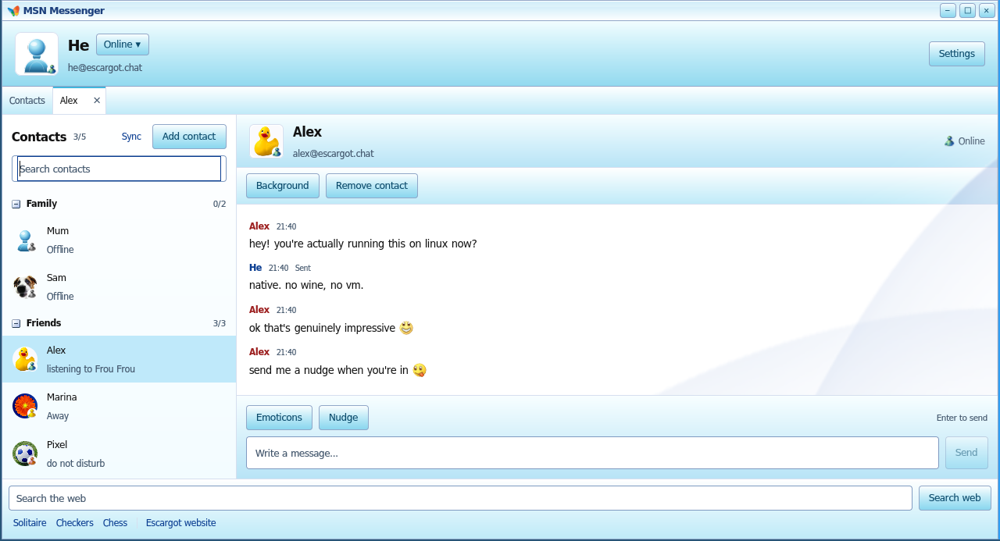
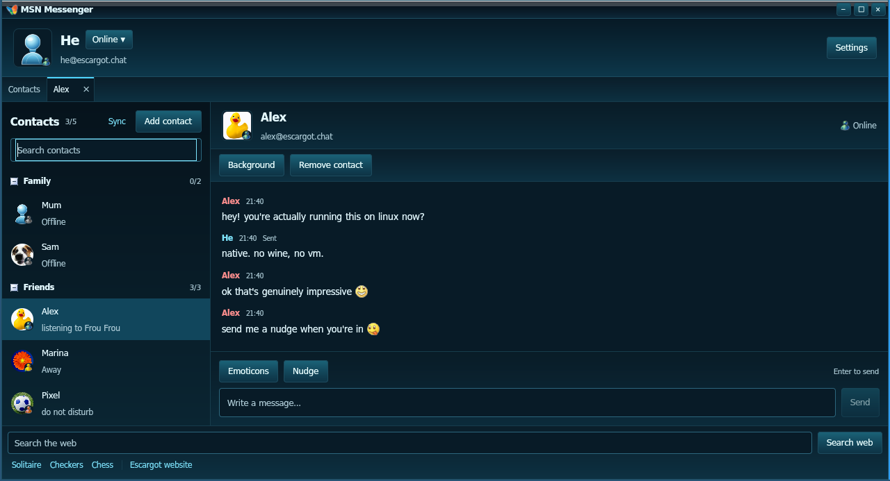

# Escargot Native

A Linux client for MSN Messenger on the [Escargot](https://escargot.chat/)
network. Rust and GPUI, with the MSN 7.5 layout, emoticons, sounds and Aero look.
It runs without Wine or Electron.



## What works

- Sign-in with an Escargot account, contact list with groups, presence and
  personal messages
- One-to-one chats with UTF-8 text, emoticons, nudges and typing indicators
- Contact requests received online or while signed out, with Accept and Not now;
  removing a contact keeps the conversation history
- Message states: Sending, Sent, and Not sent with Retry
- SQLite history, local contact search, and automatic reconnect after the
  notification connection drops; a draft survives the reconnect
- Light and Night themes, separate wallpapers for the interface and for
  conversations, and zoom from 75% to 200%
- Tabs in one window, or separate windows for each conversation
- Solitaire, Checkers and Chess



The screenshots use the built-in demo profile.

## Install

Create an Escargot account at <https://escargot.chat/>. You need Linux with
Wayland or X11, GTK 3, WebKitGTK 4.1 and a working Vulkan driver. Building from
source also needs Rust 1.85 or newer. On Arch Linux:

```sh
sudo pacman -S rust gtk3 webkit2gtk-4.1 libxkbcommon vulkan-icd-loader
```

`secret-tool` (libsecret) enables the remember-password option, and `pw-play`
(PipeWire) plays the sounds. The client runs without both.

### AUR

On Arch Linux, install the binary package from the AUR:

```sh
yay -S escargot-native-bin
```

### From source

```sh
git clone https://github.com/mafuzyk/escargot-native.git
cd escargot-native
./install.sh
msn
```

The installer builds the client and the WebKit browser helper, then puts `msn`,
`msn2` and the assets under `~/.local`. `msn2` starts a second profile with its
own settings and history. To run from the source tree without installing:

```sh
./run.sh
```

## Status

The client speaks MSNP11. Text conversations, presence, contact requests,
history and the games work. Voice calls, video, file transfer and text formatting
are not implemented.

Testing has been on Arch Linux with Sway and Hyprland. Other desktops have not
been checked.

## Credits and license

The source is [CC BY-NC 4.0](LICENSE): personal, non-commercial use. This is an
unofficial fan project, not affiliated with Microsoft or Escargot.

MSN Messenger, Windows Live Messenger, and the artwork, emoticons and sounds
extracted from the 7.5.0324 installer belong to Microsoft. Tahoma comes from
Wine, based on Bitstream Vera. The playing card deck is CC0 by Austin Gabriel
([source](https://github.com/AustinGabriel/Public-Domain-and-CC0-Playing-Cards)).
The network, protocol reference and accounts are at
<https://escargot.chat/>.
